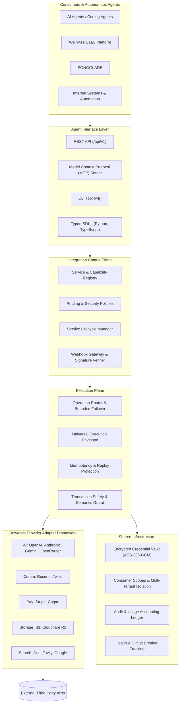

# Universal Service Integration Platform Architecture

This document defines the architectural foundation for expanding **Weirwise Token Router** from an AI routing layer into a **Universal, Agent-Native Service Integration and Execution Platform**.

The core principle: **Integrate Once. Manage Centrally. Use Everywhere.**

---

## 1. Architectural Planes



---

## 2. Universal Service Categories

The platform organizes external integrations into formal service categories with domain semantics:

| Category | Category ID | Typical Operations | Providers / Adapters |
| :--- | :--- | :--- | :--- |
| **AI & Intelligence** | `ai` | `chat_completion`, `generate_embeddings`, `speech_to_text`, `text_to_speech`, `rerank` | OpenAI, Anthropic, Gemini, OpenRouter, Deepgram, Jina |
| **Communication** | `communication` | `send_email`, `send_sms`, `voice_call`, `send_push` | Resend, Twilio, SendGrid |
| **Payments & Finance** | `payments` | `create_payment_intent`, `verify_payment`, `create_customer`, `get_balance` | Stripe, Crypto gateways |
| **Storage & Files** | `storage` | `upload_file`, `get_signed_url`, `delete_file`, `list_files` | AWS S3, Cloudflare R2 |
| **Search & Data** | `data` | `web_search`, `crawl_page`, `extract_content` | Jina Reader, Tavily, Google Search |
| **Productivity & SaaS**| `productivity` | `calendar_event`, `sync_contacts`, `create_ticket` | Google Workspace, Microsoft 365, Linear |
| **Social & Distribution**| `social` | `send_message`, `post_update`, `listen_events` | Telegram, Discord, WhatsApp |

---

## 3. Universal Service Contract & Operation Schema

Fundamentally different services are **not** forced into a single monolithic schema. Instead, each integration defines typed operations adhering to domain semantics:

```python
class ServiceCategory(str, Enum):
    AI = "ai"
    COMMUNICATION = "communication"
    PAYMENTS = "payments"
    STORAGE = "storage"
    DATA = "data"
    PRODUCTIVITY = "productivity"
    SOCIAL = "social"

class OperationSemantics(BaseModel):
    operation_id: str                   # e.g., "send_email", "create_payment_intent"
    category: ServiceCategory
    is_idempotent: bool                 # Enforces replay protection vs failover safety
    allows_automatic_failover: bool     # AI chat = True; Stripe payment intent = False!
    supports_streaming: bool
    requires_approval: bool             # Sensitive operations (e.g. transfers, bulk deletes)
    input_schema: Dict[str, Any]        # JSON schema for payload validation
    output_schema: Dict[str, Any]       # Standardized response fields
```

### Safety Semantics: Financial and Non-Idempotent Operations
- **AI queries (`chat_completion`)**: Safe for bounded failover across equivalent models upon provider error.
- **Transactional emails (`send_email`)**: Failover only if the error explicitly precedes dispatch (e.g. 503 Service Unavailable with 0 delivery attempts).
- **Payments (`create_payment_intent`)**: **ZERO automatic failover** upon timeout. A timeout does not prove the card was not charged. The system requires explicit transaction status query before any retry.

---

## 4. Universal Execution Envelope

Every execution request (REST, MCP, or SDK) returns a standard execution envelope:

```json
{
  "request_id": "req_01hz8k9m...",
  "application": "songglade",
  "consumer_id": "cons_uuid...",
  "category": "communication",
  "service": "email",
  "operation": "send_email",
  "provider": "resend",
  "status": "success",
  "status_code": 200,
  "duration_ms": 142.5,
  "failover_attempts": 0,
  "idempotency_key": "idemp_abc123",
  "usage": {
    "units": 1,
    "unit_type": "emails"
  },
  "estimated_cost_usd": 0.001000,
  "data": {
    "id": "email_msg_12345",
    "status": "queued"
  },
  "error": null
}
```

---

## 5. Webhook Gateway Architecture

The Control Plane includes a unified webhook receiver `/api/v1/webhooks/{provider_name}`:
1. **Signature Verification**: Dispatched to `adapter.verify_webhook_signature(headers, body, secret)`.
2. **Replay Protection**: Header nonce and timestamp checking against cache.
3. **Event Normalization**: Provider payload converted to a canonical event (e.g. `payment.succeeded`, `email.delivered`).
4. **Idempotent Dispatch**: Consumer dispatching with delivery tracking and dead-letter queue.

---

## 6. Free-Tier Intelligence & Smart Cost Routing

The Token Router incorporates dedicated cost-optimization and rate-limit intelligence:

### 1. Provider Pricing Registry (`token_router/core/pricing.py`)
- Standardized `ModelPricing` catalog defining input/output per-million token costs, per-request costs, currency, context window, and quality scores.
- Documented model tiers: `free` (e.g. Gemini 1.5 Flash within quota limits, OpenRouter free models), `paid` (GPT-4o, Claude 3.5 Sonnet), and `local` (0.0 cost local engines).
- Dynamically queryable and updatable via `/api/v1/pricing` and admin `/api/v1/admin/pricing`.

### 2. Free-Tier Quota Windows (`token_router/core/quota.py`)
- Documented limits:
  - **Gemini Free Tier**: 15 RPM, 1,000,000 TPM, 1,500 RPD (gemini-1.5-flash); 2 RPM, 32,000 TPM, 50 RPD (gemini-1.5-pro).
  - **OpenRouter Free Tier**: 20 RPM, 200,000 TPM, 200 RPD.
- Thread-safe in-memory rolling 60-second window tracking (`RPM`, `TPM`) and calendar UTC midnight reset tracking (`RPD`).
- Re-eligibility is restored automatically when the rolling or calendar window clears, without requiring service restarts.

### 3. Intelligent Routing Strategies
- **`free_tier_first`**: Checks quota windows of free-tier/local credentials first. If available, routes to zero-cost inference. If all free-tier quotas are exhausted, falls back seamlessly to paid credentials.
- **`lowest_cost`**: Uses token pricing models and balances tenant/credential monthly spend to minimize aggregate bills.
- **`quality_first`**: Ranks providers by model benchmark and quality scoring.
- **`priority` / `round_robin` / `least_recently_used` / `weighted`**: Preserved for deterministic operational routing.

### 4. Local Provider Support (`token_router/adapters/local_adapter.py`)
- Native support for local inference daemons (Ollama, vLLM, LM Studio) at 0.0 marginal token cost.
- Verified active health-check probes before routing requests. Fails closed and falls over to cloud providers if the local daemon is offline or connection is refused.

### 5. Multi-Consumer Budget Guard
- Pre-route enforcement against `Consumer.monthly_budget_usd`. Requests are blocked with `PermissionError` when current monthly spend exceeds the configured allocation.

---

## 7. Distributed Quota Management & Upstream Rate-Limit Intelligence

### 1. Distributed Multi-Instance Architecture (`token_router/core/quota.py`)
- Centralized quota management across horizontally scaled Token Router containers.
- Backed by **Redis sliding window counters** executing an atomic Lua script (`REDIS_RESERVE_SCRIPT`) using sorted sets (`ZADD`, `ZREMRANGEBYSCORE`, `ZCARD`).
- **Production Redis Persistence & Recovery**:
  - Configured with Append-Only File (`appendonly yes`) and `appendfsync everysec` for durable, sub-second transaction durability.
  - Backed by RDB snapshotting (`save 900 1 300 10 60 10000`) for compact recovery image.
  - Redis data volume backed by persistent Docker named volume (`token_router_redis_data` / `weirwise_prod_redis_data`).
  - Metric mode reporting inspects Redis persistence status (`aof_enabled` vs `rdb_only`).
  - Strict production verification flag `REQUIRE_REDIS_PERSISTENCE=true` enforces that Redis has AOF enabled on startup.
- **Atomic Two-Phase Reservation**:
  - Phase 1: During credential candidate selection, `is_eligible` checks window availability without mutating counters.
  - Phase 2: Prior to outbound dispatch, `reserve_execution` atomically claims the estimated tokens and RPM slot across all cluster nodes with a unique `reservation_id`. If another node consumed the remaining quota concurrently, routing skips to the next eligible credential.
- **Fail-Closed Failure Policy**:
  - When `DISTRIBUTED_MODE=true` or `QUOTA_FAILURE_POLICY="fail_closed"`, if Redis is unreachable, requests fail closed by raising `RedisUnavailableError` (HTTP 503/429) rather than silently permitting multi-node oversubscription.
  - Single-instance local fallback is strictly confined to explicitly configured single-instance mode (`DISTRIBUTED_MODE=false`, `QUOTA_FAILURE_POLICY="local_fallback"`).
- **Reservation Recovery & Ambiguous Outcome Safety**:
  - Confirmed pre-dispatch network failures safely invoke `release_reservation()`.
  - Ambiguous outcomes (e.g. timeout after dispatch, unknown execution status) intentionally preserve reservations to protect provider quota integrity and prevent duplicate downstream charges.
  - Expired reservations older than 60 seconds are automatically reclaimed via sliding window `ZREMRANGEBYSCORE` on subsequent requests, guaranteeing interrupted or crashed worker reservations never cause permanent quota starvation.

### 2. Provider Rate-Limit Extraction (`token_router/core/rate_limits.py`)
- Standardized extraction of vendor-specific rate-limit response headers:
  - **OpenAI**: `x-ratelimit-remaining-requests`, `x-ratelimit-remaining-tokens`, `x-ratelimit-reset-requests`, `x-ratelimit-reset-tokens`.
  - **Anthropic**: `anthropic-ratelimit-requests-remaining`, `anthropic-ratelimit-tokens-remaining`, `anthropic-ratelimit-requests-reset`.
  - **Gemini**: `x-ratelimit-remaining`, structured `429 RESOURCE_EXHAUSTED` error message regex extraction (`"Please retry after X.Xs"`).
  - **OpenRouter**: `x-ratelimit-remaining`, `x-ratelimit-limit`, `x-ratelimit-reset`.
  - **RFC 7231**: `Retry-After` seconds or HTTP-date canonical parsing.

### 3. Dynamic Reconciliation & Cooldown Enforcement
- `QuotaManager.reconcile_from_headers` ingests upstream provider headers post-request.
- If upstream signals `remaining_requests == 0`, subsequent reservations are rejected immediately.
- If `Retry-After` is present, a temporary cooldown timestamp is assigned on the `ProviderCredential` in the database and in Redis, steering traffic to alternate credentials until the provider reset window clears.
