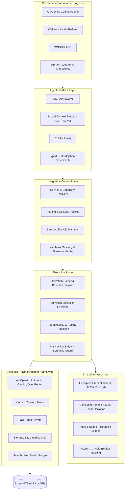

# Universal Service Integration Platform Architecture

This document defines the architectural foundation for expanding **Weirwise Token Router** from an AI routing layer into a **Universal, Agent-Native Service Integration and Execution Platform**.

The core principle: **Integrate Once. Manage Centrally. Use Everywhere.**

---

## 1. Architectural Planes



---

## 2. Universal Service Categories

The platform organizes external integrations into formal service categories with domain semantics:

| Category | Category ID | Typical Operations | Providers / Adapters |
| :--- | :--- | :--- | :--- |
| **AI & Intelligence** | `ai` | `chat_completion`, `generate_embeddings`, `speech_to_text`, `text_to_speech`, `rerank` | OpenAI, Anthropic, Gemini, OpenRouter, Deepgram, Jina |
| **Communication** | `communication` | `send_email`, `send_sms`, `voice_call`, `send_push` | Resend, Twilio, SendGrid |
| **Payments & Finance** | `payments` | `create_payment_intent`, `verify_payment`, `create_customer`, `get_balance` | Stripe, Crypto gateways |
| **Storage & Files** | `storage` | `upload_file`, `get_signed_url`, `delete_file`, `list_files` | AWS S3, Cloudflare R2 |
| **Search & Data** | `data` | `web_search`, `crawl_page`, `extract_content` | Jina Reader, Tavily, Google Search |
| **Productivity & SaaS**| `productivity` | `calendar_event`, `sync_contacts`, `create_ticket` | Google Workspace, Microsoft 365, Linear |
| **Social & Distribution**| `social` | `send_message`, `post_update`, `listen_events` | Telegram, Discord, WhatsApp |

---

## 3. Universal Service Contract & Operation Schema

Fundamentally different services are **not** forced into a single monolithic schema. Instead, each integration defines typed operations adhering to domain semantics:

```python
class ServiceCategory(str, Enum):
    AI = "ai"
    COMMUNICATION = "communication"
    PAYMENTS = "payments"
    STORAGE = "storage"
    DATA = "data"
    PRODUCTIVITY = "productivity"
    SOCIAL = "social"

class OperationSemantics(BaseModel):
    operation_id: str                   # e.g., "send_email", "create_payment_intent"
    category: ServiceCategory
    is_idempotent: bool                 # Enforces replay protection vs failover safety
    allows_automatic_failover: bool     # AI chat = True; Stripe payment intent = False!
    supports_streaming: bool
    requires_approval: bool             # Sensitive operations (e.g. transfers, bulk deletes)
    input_schema: Dict[str, Any]        # JSON schema for payload validation
    output_schema: Dict[str, Any]       # Standardized response fields
```

### Safety Semantics: Financial and Non-Idempotent Operations
- **AI queries (`chat_completion`)**: Safe for bounded failover across equivalent models upon provider error.
- **Transactional emails (`send_email`)**: Failover only if the error explicitly precedes dispatch (e.g. 503 Service Unavailable with 0 delivery attempts).
- **Payments (`create_payment_intent`)**: **ZERO automatic failover** upon timeout. A timeout does not prove the card was not charged. The system requires explicit transaction status query before any retry.

---

## 4. Universal Execution Envelope

Every execution request (REST, MCP, or SDK) returns a standard execution envelope:

```json
{
  "request_id": "req_01hz8k9m...",
  "application": "songglade",
  "consumer_id": "cons_uuid...",
  "category": "communication",
  "service": "email",
  "operation": "send_email",
  "provider": "resend",
  "status": "success",
  "status_code": 200,
  "duration_ms": 142.5,
  "failover_attempts": 0,
  "idempotency_key": "idemp_abc123",
  "usage": {
    "units": 1,
    "unit_type": "emails"
  },
  "estimated_cost_usd": 0.001000,
  "data": {
    "id": "email_msg_12345",
    "status": "queued"
  },
  "error": null
}
```

---

## 5. Webhook Gateway Architecture

The Control Plane includes a unified webhook receiver `/api/v1/webhooks/{provider_name}`:
1. **Signature Verification**: Dispatched to `adapter.verify_webhook_signature(headers, body, secret)`.
2. **Replay Protection**: Header nonce and timestamp checking against cache.
3. **Event Normalization**: Provider payload converted to a canonical event (e.g. `payment.succeeded`, `email.delivered`).
4. **Idempotent Dispatch**: Consumer dispatching with delivery tracking and dead-letter queue.
