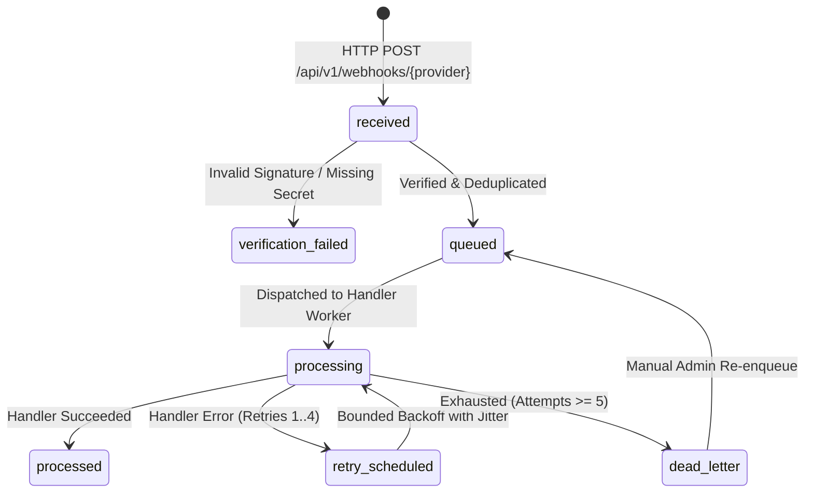

# Durable Webhook Architecture

This document describes the durable webhook ingestion, signature verification, persistent deduplication, and retry architecture in **Weirwise Token Router**.

---

## 1. Webhook Lifecycle States

Inbound webhook events transition through explicit lifecycle states:

---

## 2. Dedicated Webhook Secrets

Webhook signing secrets are completely separated from outbound provider API keys:
- Stored in `WebhookSecret` table encrypted with AES-256-GCM.
- Scoped to `(provider_name, consumer_id)`.
- Supports secret rotation without affecting outbound API credentials.

---

## 3. Provider-Specific Verification Protocols

- **Stripe**: Parses `Stripe-Signature: t={timestamp},v1={sig}`. Enforces a 300-second timestamp tolerance and computes HMAC-SHA256 over `{timestamp}.{raw_body}` using constant-time comparison (`hmac.compare_digest`).
- **Twilio**: Validates `X-Twilio-Signature` using account auth tokens and request parameters.

---

## 4. Durable Deduplication & Replay Protection

The database maintains unique tracking over `(provider_name, external_event_id)`:
- Inbound requests matching an existing recorded event return HTTP 200 with `{ "status": "duplicate", ... }` immediately.
- Duplicate events are never re-dispatched to business handlers.
